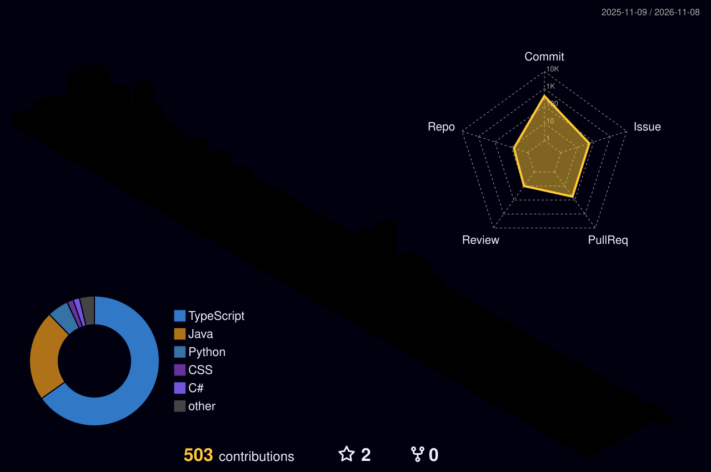

  

 

  

 

  I build clean, scalable systems and solve real-world problems through code. 
  I work across multiple technologies and keep learning, experimenting and improving.

 

### Stack

<table>
  <tr>
    <td align="right"><b>LANGUAGES</b></td>
    <td></td>
  </tr>
  <tr>
    <td align="right"><b>FRAMEWORKS</b></td>
    <td></td>
  </tr>
  <tr>
    <td align="right"><b>DATABASES</b></td>
    <td></td>
  </tr>
  <tr>
    <td align="right"><b>CLOUD</b></td>
    <td></td>
  </tr>
</table>
 

<picture>
  
</picture>

 

